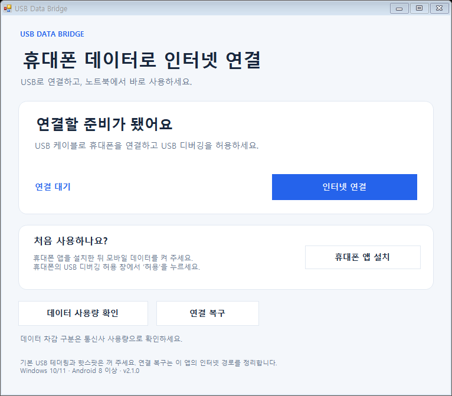

# USB Data Bridge

Android 휴대폰의 모바일 인터넷을 USB 케이블로 Windows 노트북에서 사용할 수 있는 무료 프로그램입니다.

## 다운로드

### [⬇ Windows 실행 ZIP 다운로드](https://github.com/Cronosfather/USBDataBridge/releases/download/v2.1.0/USBDataBridge-v2.1.0-Windows-x64.zip)

**Windows 10/11 64비트 · Android 8 이상 · 데이터 전송이 가능한 USB 케이블**

ZIP 안에 Windows 실행 파일, 휴대폰 앱, 연결에 필요한 구성요소가 들어 있습니다. 별도로 소스를 빌드하거나 Python·Java를 설치할 필요가 없습니다.

[배포 페이지와 사용 안내](https://github.com/Cronosfather/USBDataBridge/releases/latest)

## 처음 사용할 때

1. 위 실행 ZIP을 다운로드하고 **모든 파일의 압축을 해제**합니다. ZIP 안에서 바로 실행하거나 EXE만 따로 옮기지 마세요.
2. 휴대폰의 **모바일 데이터**와 **USB 디버깅**을 켭니다. 기본 USB 테더링·핫스팟은 끕니다.
3. 휴대폰과 노트북을 USB 케이블로 연결하고, 휴대폰에 표시되는 **USB 디버깅 허용** 창에서 허용합니다.
4. 압축을 푼 폴더의 **`USBDataBridge.exe`**를 실행하고 관리자 권한을 허용합니다.
5. **휴대폰 앱 설치**를 누릅니다. 휴대폰에 권한 안내가 나오면 확인합니다.
6. **인터넷 연결**을 누르고 사이트가 열리는지 확인합니다.

휴대폰 앱이 준비되지 않았다면 휴대폰에서 USB Data Bridge를 열고 **연결 준비**를 누른 뒤 다시 연결하세요.

## 평소 사용할 때

휴대폰을 USB로 연결 → **인터넷 연결** → 사용 후 **연결 끊기**.

| 버튼 | 하는 일 |
|---|---|
| 인터넷 연결 / 연결 끊기 | 노트북 인터넷 연결을 시작하거나 종료합니다. |
| 휴대폰 앱 설치 | 처음 설치하거나 휴대폰 앱을 업데이트합니다. |
| 데이터 사용량 확인 | 통신사의 연결 전·후 사용량을 직접 비교합니다. |
| 연결 복구 | 이 프로그램이 설정한 인터넷 경로를 정리합니다. |

## 연결이 안 될 때

- **휴대폰을 찾지 못함:** 휴대폰 잠금을 풀고 USB 디버깅 허용 창을 확인하세요. 충전 전용 케이블 대신 데이터 전송 케이블을 사용하세요.
- **휴대폰 앱이 준비되지 않음:** 휴대폰의 모바일 데이터로 웹사이트가 열리는지 확인한 뒤, 휴대폰 앱의 **연결 준비**를 누르세요.
- **연결 후 사이트가 열리지 않음:** **연결 끊기 → 연결 복구 → 인터넷 연결** 순서로 다시 시도하세요.
- **프로그램 종료 후 기존 인터넷이 안 됨:** 같은 폴더의 **`인터넷경로복구.exe`**를 실행하세요.
- **앱 설치 실패:** 휴대폰의 설치 차단 안내를 확인하세요. 다른 서명으로 설치한 이전 앱이 있다면 제거 후 다시 설치해야 할 수 있습니다.

### Galaxy 휴대폰에서 USB 디버깅이 차단될 때

1. **설정 → 보안 및 개인정보 보호 → 보안 위험 자동 차단**을 끄세요.
2. **설정 → 개발자 옵션 → USB 디버깅**을 켜세요.
3. USB 케이블을 다시 연결하고 휴대폰에 뜨는 **USB 디버깅 허용**을 누르세요.

이 설정은 USB 명령과 외부 앱 설치 차단을 해제합니다. 본인이 신뢰하는 노트북에 연결할 때만 변경하고, 사용을 마치면 보안 위험 자동 차단을 다시 켜세요. 메뉴 이름은 휴대폰 버전에 따라 다를 수 있습니다. [삼성 안내](https://www.samsungsvc.co.kr/solution/1711930)

### Windows 보안 창이 뜰 때

이 저장소의 Releases에서 받은 파일인지 확인한 뒤, **Windows의 PC 보호** 창에서 **추가 정보 → 실행**을 누르세요. 이어서 관리자 권한 창이 뜨면 허용하세요. 화면에 따라 상세 안내가 **고급**으로 표시될 수 있으므로 실제 창의 버튼 이름을 확인하세요.

### AdapterCheck.dll을 불러오지 못할 때

1. 실행 폴더에 **`AdapterCheck.dll`**이 있는지 확인하세요. 없다면 실행 ZIP의 모든 파일을 다시 압축 해제하세요.
2. GitHub에서 받은 ZIP을 **우클릭 → 속성**으로 열고, **차단 해제** 항목이 있으면 체크한 뒤 **적용**을 누르세요.
3. 차단을 해제한 ZIP을 **새 폴더에 전부 압축 해제**하고 다시 실행하세요.

### 재시작 후 연결 가능한 휴대폰이 없다고 나올 때

프로그램을 다시 시작한 뒤 **“적용 가능한 핸드폰이 없어요”** 또는 휴대폰을 찾지 못했다는 메시지가 나오면, USB 케이블을 뺐다가 다시 꽂으세요. 휴대폰 잠금을 풀고 디버깅 허용 창을 확인한 뒤, 위의 처음 사용 절차를 차근차근 다시 진행하세요. 휴대폰 앱이 준비되지 않았다면 **연결 준비**도 눌러 주세요. 그래도 감지되지 않으면 데이터 전송이 가능한 다른 케이블이나 USB 포트로 시도하세요.

## 업데이트

기존 프로그램에서 **연결 끊기**를 누르고 종료한 뒤, 새 ZIP을 새 폴더에 압축 해제하세요. 새 프로그램의 **휴대폰 앱 설치**를 눌러 휴대폰 앱도 업데이트합니다.

## 데이터 사용과 지원 범위

모바일 데이터 요금과 일반/공유 데이터 차감은 통신사 기준으로 적용됩니다. **일반 데이터로만 차감되는 것을 보장하지 않으며, 차감 항목을 자동 판별하지 않습니다.** 통신사 앱의 사용량으로 확인하세요.

현재 배포판은 개발 버전입니다. 기기·통신사·프로그램에 따라 동작이 다를 수 있습니다. 일부 게임·음성 통신·VPN은 연결되지 않을 수 있습니다.

## 개발 및 라이선스

빌드 방법은 [개발자 안내](docs/BUILDING.md), 구성요소와 라이선스는 [외부 구성요소 안내](docs/DEPENDENCIES.md), 확인한 테스트 범위는 [검증 기록](docs/VALIDATION.md)에서 볼 수 있습니다.

직접 제작한 소스는 [MIT](LICENSE) 라이선스입니다. ADB, tun2socks, Wintun에는 각 프로젝트의 별도 라이선스가 적용됩니다.
